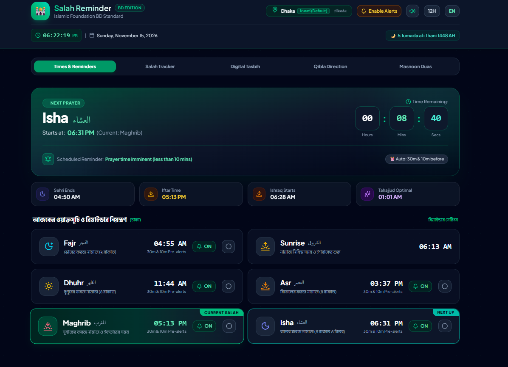
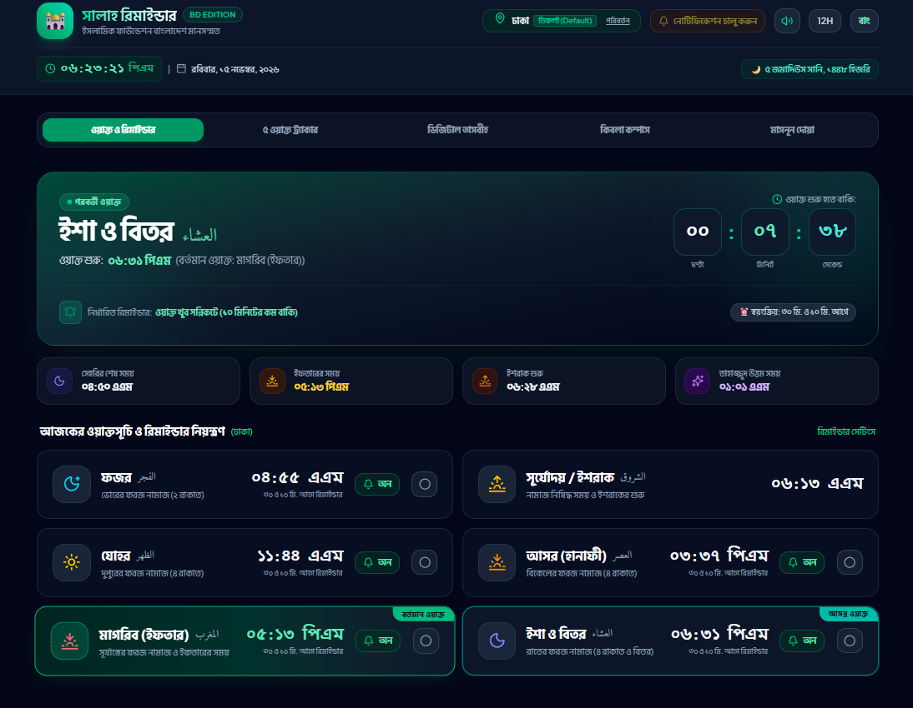
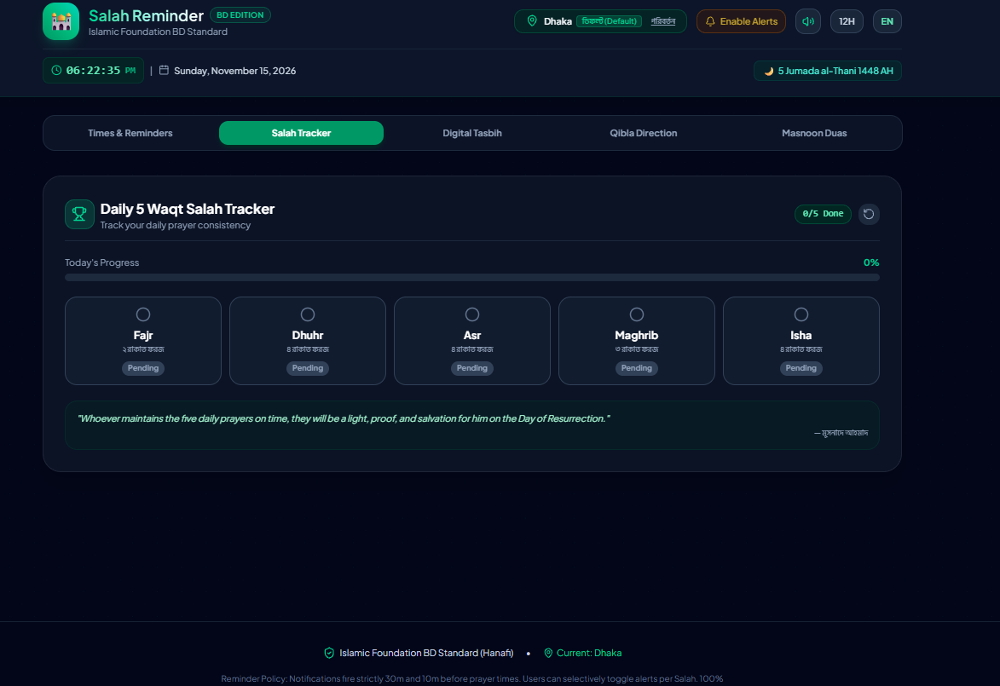
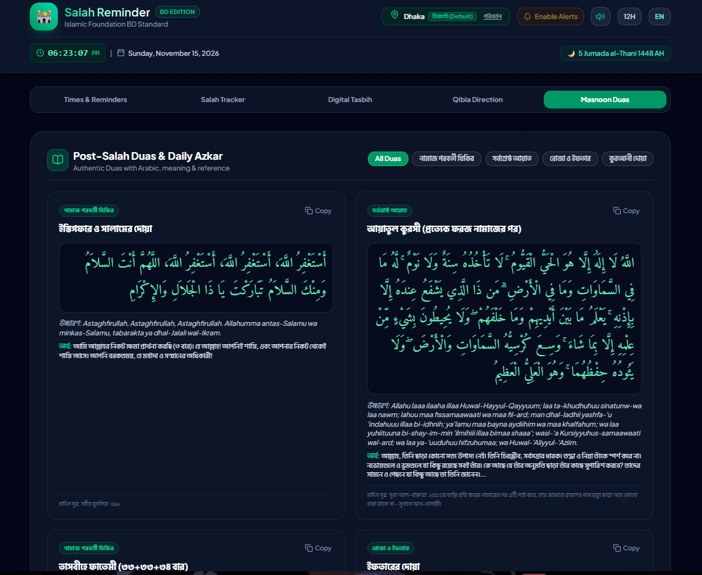

# 🕌 Salah Time Reminder Bangladesh
### সালাহ রিমাইন্ডার ও নামাজের সময়সূচি

<p align="center">
  
</p>

<h3 align="center">Your Daily Islamic Companion — Pray on Time, Stay Connected with Allah.</h3>

<p align="center">
  A modern, responsive Islamic companion designed specifically for Muslims in Bangladesh, featuring accurate prayer times, smart Salah reminders, Qibla direction, digital Tasbih, daily prayer tracking, and authentic Islamic duas.
</p>

<p align="center">
  <a href="https://salah-time-reminder.vercel.app/"><strong>🌐 Live Demo</strong></a> •
  <a href="https://github.com/Asadul09/salah-time-reminder"><strong>📂 GitHub Repository</strong></a>
</p>

<p align="center">
  
  
  
  
</p>

---

## 🌐 Live Application

**Try Salah Time Reminder Bangladesh:**

👉 https://salah-time-reminder.vercel.app/

A mobile-first Islamic web application with real-time prayer schedules, personalized reminders, and essential daily Islamic tools.

## 📸 Screenshots & Preview

Explore the application's interface and features.

### 🏠 Home Dashboard

| English Interface | বাংলা Interface |
|:---:|:---:|
|  |  |
| English Dashboard | বাংলা ড্যাশবোর্ড |

### 📱 Application Features

| Preview 1 | Preview 2 |
|:---:|:---:|
|  |  |

---

## ✨ Key Features

### 📍 1. Smart Location & Prayer Time Calculation
- **Default Location:** Dhaka Division, Bangladesh.
- **All 8 Divisions:** Dhaka, Chattogram, Sylhet, Rajshahi, Khulna, Barishal, Rangpur, and Mymensingh.
- **GPS Detection:** Automatically detects the user's precise geographical coordinates.
- **Prayer Calculation:** Uses the `adhan` library with Karachi calculation parameters and Hanafi Asr methodology, aligned with the intended Bangladesh prayer-time convention.

### ⏰ 2. Intelligent Two-Stage Salah Reminders
- **30-Minute Reminder:** Early notification to prepare for Salah.
- **10-Minute Reminder:** A second reminder shortly before prayer time.
- **Five Prayer Support:** Fajr, Dhuhr, Asr, Maghrib, and Isha.
- **Individual Controls:** Enable or disable reminders for each prayer separately.
- **Multiple Alert Methods:** Browser notifications, in-app toast alerts, synthesized audio chimes, and vibration where supported.

### 🕒 3. Live Clock & Prayer Countdown
- Real-time digital clock with ticking seconds.
- 12-hour and 24-hour clock formats.
- Gregorian and Hijri calendar display.
- Bengali and English date presentation.
- Live countdown to the next Salah.

### 🌙 4. Ramadan & Voluntary Prayer Times
- Daily Sehri ending time.
- Iftar time.
- Tahajjud prayer window.
- Ishraq and Chasht prayer timings.

### 📿 5. Digital Tasbih & Dhikr Counter
- Interactive digital Tasbih counter.
- Quick targets: 33, 99, 100, or unlimited.
- Audio click and vibration feedback.
- Daily Dhikr accumulation.
- Confetti celebration when a target is completed.

### 🧭 6. Qibla Compass
- Calculates the direction of the Holy Kaaba.
- Live compass orientation using supported mobile device sensors.
- Visual compass interface.
- Distance calculation from the user's location to Makkah.

### ✅ 7. Daily Five-Waqt Salah Tracker
- Track all five daily prayers.
- Interactive daily completion checklist.
- Visual progress bar and completion percentage.
- Motivational Hadith quotations.

### 📖 8. Islamic Duas & Post-Salah Azkar
- Authentic post-Salah supplications.
- Ayatul Kursi.
- Tasbih-e-Fatimi.
- Sehri intention and Iftar dua.
- Arabic text, transliteration, and Bengali translation.
- Hadith references and one-click copy functionality.

### 🎨 9. Modern UI & User Experience
- Dark emerald and golden Islamic-inspired theme.
- Modern glassmorphism design.
- Fully responsive mobile-first layout.
- Bengali and English language switching.
- Dedicated mobile bottom navigation.
- Progressive Web App (PWA) support for installation on supported devices.

---

## 🛠️ Technology Stack

| Technology | Purpose |
|---|---|
| React 19 | Frontend UI development |
| Vite | Development server and build tool |
| Tailwind CSS | Responsive styling |
| Lucide React | Icon library |
| Adhan | Islamic prayer time calculations |
| Web Audio API | Audio notifications |
| Notifications API | Browser notifications |
| Navigator Vibration API | Haptic feedback |
| Canvas Confetti | Celebration effects |
| JavaScript | Application logic |
| Vercel | Deployment and hosting |

---

## 🚀 Getting Started

Follow these instructions to run the project locally.

### Prerequisites
- Node.js v18 or later
- npm
- Git

### 1. Clone the Repository

```bash
git clone https://github.com/Asadul09/salah-time-reminder.git
```

### 2. Navigate to the Project

```bash
cd salah-time-reminder
```

### 3. Install Dependencies

```bash
npm install
```

### 4. Start Development Server

```bash
npm run dev
```

Open your browser and visit:

```text
http://localhost:5173
```

### 5. Build for Production

```bash
npm run build
```

The optimized production files will be generated inside the `dist` directory.

---

## 📁 Project Highlights

- Responsive and mobile-first architecture.
- Location-based prayer time calculations.
- Two-stage notification scheduling.
- Interactive Islamic utilities.
- Bilingual user interface.
- Installable PWA experience.
- Modern and accessible design.

## 🎯 Project Objective

The goal of Salah Time Reminder Bangladesh is to make daily Islamic practices easier through technology.

By combining accurate prayer schedules, proactive reminders, and essential Islamic tools in one application, users can stay organized, track their prayers, and maintain a stronger connection with their daily worship.

## 🔮 Future Improvements

- Cloud synchronization for user preferences.
- User accounts and personalized dashboards.
- More advanced notification scheduling.
- Additional Islamic learning resources.
- Expanded customization options.

## 👨‍💻 Developer

**MD Asadul Islam**  
Software Engineer | Full-Stack MERN Developer

- 🌐 Portfolio: https://portfolio-website-pi-five-83.vercel.app/
- 💻 GitHub: https://github.com/Asadul09
- 🚀 Project: https://salah-time-reminder.vercel.app/

## 📄 License

This project is licensed under the **MIT License**. See the [LICENSE](LICENSE) file for details.

---

<p align="center">
  Made with ❤️ and ☪️ for the Muslim community of Bangladesh.
</p>

<p align="center">
  <strong>Pray on Time. Remember Allah. Every Day.</strong>
</p>
